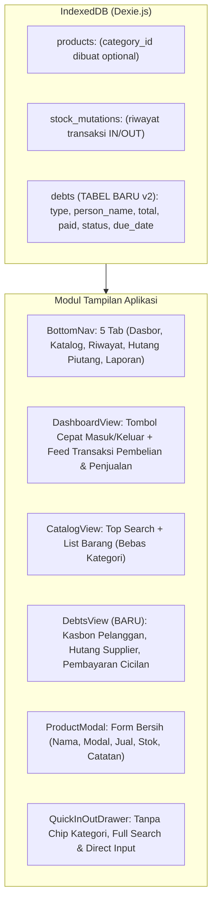

# Dokumen Analisis & Rencana Implementasi: Pembaruan Toko Tari Jaya

**Tanggal Analisis:** 15 Oktober 2026  
**Status:** Perencanaan & Verifikasi Arsitektur  
**Tujuan:** Menyederhanakan alur kerja aplikasi (menghapus kategori, fokus pada pencarian dan transaksi dasbor) serta menambahkan modul baru **Buku Hutang Piutang**.

---

## 1. Ringkasan Kebutuhan Klien

Berdasarkan permintaan terbaru dari klien:
1. **Tidak perlu ada Kategori:** Menghilangkan seluruh sistem kategori (chip filter, modal kelola kategori, dropdown kategori di form barang, badge kategori pada kartu barang).
2. **Cukup pakai Search:** Menjadikan kolom pencarian (*search bar*) sebagai fitur utama pencarian barang yang responsif (nama & catatan barang).
3. **Penyederhanaan Halaman Dasbor:** Menghilangkan blok 4 kartu ringkasan finansial (*Omzet Penjualan*, *Estimasi Laba Kotor*, *Belanja Modal*, *Total Katalog*). Dasbor difokuskan murni pada barang yang dilakukan pembelian (Masuk) dan penjualan (Keluar).
4. **Fitur & Halaman Baru (Hutang Piutang):** Modul pencatatan kasbon pelanggan (*Piutang*) dan kewajiban bayar ke pemasok/distributor (*Hutang*), lengkap dengan fitur cicilan, status lunas, jatuh tempo, dan pengingat WhatsApp.

---

## 2. Analisis Arsitektur & Dampak Perubahan



---

## 3. Rincian Implementasi per Poin

### A. Poin 1 & 2: Eliminasi Kategori & Optimalisasi Pencarian

#### 1. Form Tambah & Ubah Produk (`ProductModal.tsx`)
- **Sebelumnya:** Terdapat dropdown kategori, opsi default "Pilih Kategori", tombol modal kelola kategori, dan logika deteksi otomatis kategori.
- **Perubahan:**
  - Hapus dropdown kategori dan tombol kelola kategori.
  - Hapus validasi kategori pada form submit.
  - Form menjadi sangat ramping dan cepat:
    1. Nama Barang (lengkap dengan autokomplit riwayat)
    2. Harga Beli / Modal (Rp)
    3. Harga Jual (Rp)
    4. Sisa / Stok Awal
    5. Catatan / Vendor

#### 2. Tampilan Katalog (`CatalogView.tsx`)
- **Sebelumnya:** Terdapat tombol *Tag* (kelola kategori), bilah horizontal kategori (*Semua*, *Makanan*, *Minuman*), dan badge kategori di tiap kartu.
- **Perubahan:**
  - Hapus seluruh baris horizontal chip kategori.
  - Hapus tombol kelola kategori dan `CategoryModal`.
  - Top bar menjadi bersih: Kolom pencarian penuh yang responsif + tombol hijau "+ Tambah".
  - Pencarian mencocokkan nama barang dan catatan pasokan.
  - Pilihan sorting (Terbaru, A-Z, Z-A, Stok Sedikit-Banyak, Stok Banyak-Sedikit, Harga) tetap dipertahankan di sub-bar.

#### 3. Drawer Transaksi Masuk/Keluar (`QuickInOutDrawer.tsx`)
- Hapus chip kategori horizontal scroller di bawah search bar.
- Kasir cukup mengetik nama barang di kolom pencarian.
- Input angka kuantitas langsung dan proteksi batas stok yang sudah dibuat sebelumnya tetap dipertahankan.

#### 4. Kartu Produk & Detail (`ProductContainerCard.tsx`, `ProductDetailModal.tsx`)
- Hapus badge kategori dari kartu produk dan kartu container.

#### 5. Database & Operasi (`schema.ts`, `operations.ts`)
- Buat `category_id` menjadi opsional (`category_id?: number`) pada interface `Product`.
- Hapus pengecekan `if (!category_id) throw Error` pada `createProduct` dan `updateProduct`.

---

### B. Poin 3: Penyederhanaan Dasbor (Fokus Transaksi Pembelian & Penjualan)

#### 1. Komponen yang Dihapus dari `DashboardView.tsx`:
- Blok 4 Kartu Metrik:
  - ❌ *Omzet Penjualan*
  - ❌ *Estimasi Laba Kotor*
  - ❌ *Belanja Modal*
  - ❌ *Total Katalog*
- Banner teks *"Ringkasan Hari Ini"*.

#### 2. Tampilan Baru Dasbor:
- **Header Tanggal & Status Toko:** Tanggal hari ini dan indikator kasir aktif.
- **Tombol Pintasan Transaksi Cepat:**
  - Tombol Hijau: **+ Masuk** (Pembelian dari supplier / Kulakan)
  - Tombol Merah: **- Keluar** (Penjualan ke pelanggan)
- **Banner Peringatan Stok Kritis (Low Stock):** Tetap ditampilkan jika ada barang yang hampir habis agar toko tahu barang apa yang harus segera dibeli.
- **Feed Barang Transaksi Hari Ini:**
  - Tab Filter: **Semua Transaksi** | **Pembelian (Masuk)** | **Penjualan (Keluar)**.
  - Daftar barang yang ditransaksikan hari ini:
    - Nama barang & catatan/vendor.
    - Jumlah unit (contoh: `+20 unit` hijau atau `-5 unit` merah).
    - Harga satuan & subtotal nilai transaksi.
    - Jam transaksi & tombol pembatalan (*Void/Rollback*) yang aman.
  - Jika belum ada transaksi: Tampilan kosong ramah dengan tombol ajakan mencatat transaksi.

---

### C. Poin 4: Modul Baru Buku Hutang Piutang

#### 1. Definisi Data (`DebtRecord` di `src/db/schema.ts`)
```typescript
export interface DebtRecord {
  id?: number;
  type: 'PIUTANG' | 'HUTANG'; // PIUTANG: Kasbon pembeli, HUTANG: Utang toko ke supplier
  person_name: string;        // Nama Pelanggan / Supplier (Wajib)
  phone?: string;             // No WhatsApp/Telepon untuk kirim tagihan (Opsional)
  total_amount: number;       // Total nilai hutang/piutang (IDR, Wajib)
  paid_amount: number;        // Jumlah yang sudah dibayar/dicicil (IDR, Default: 0)
  due_date?: string;          // Tanggal jatuh tempo (Opsional, format YYYY-MM-DD)
  status: 'UNPAID' | 'PARTIAL' | 'PAID'; // Otomatis terkalkulasi
  notes?: string;             // Catatan barang yang dihutang (misal: "Beras 5 sak & Minyak")
  created_at: string;         // ISO timestamp
  updated_at: string;         // ISO timestamp
}
```

#### 2. Evolusi Skema Dexie (`schema.ts`)
Tambahkan versi 2 pada `InventoryDatabase` tanpa merusak data lama:
```typescript
this.version(2).stores({
  debts: '++id, type, person_name, status, due_date, created_at, updated_at'
});
```

#### 3. Fungsi Operasi Database (`src/db/operations.ts`)
- `createDebt(data: Omit<DebtRecord, 'id' | 'created_at' | 'updated_at'>): Promise<number>`
- `updateDebt(id: number, updates: Partial<DebtRecord>): Promise<void>`
- `recordDebtPayment(id: number, amount: number): Promise<void>`  
  *(Menambah `paid_amount`, otomatis ubah status ke `PAID` jika lunas atau `PARTIAL` jika cicilan)*
- `deleteDebt(id: number): Promise<void>`

#### 4. Custom Hook (`src/hooks/useDebts.ts`)
- Mengambil daftar hutang piutang real-time dari Dexie.
- Kalkulasi otomatis:
  - `totalReceivable` (Total Piutang Belum Lunas - uang toko di luar)
  - `totalPayable` (Total Hutang Belum Lunas - kewajiban toko ke supplier)
  - Filter berdasarkan tipe (`ALL`, `PIUTANG`, `HUTANG`) dan status (`ACTIVE`, `PAID`, `ALL`).

#### 5. Halaman Tampilan Baru (`src/views/DebtsView.tsx`)
- **2 Kartu Ringkasan Atas:**
  - 💳 **Piutang Pelanggan (Kasbon):** Rp X.XXX.XXX *(Uang yang harus ditagih)*
  - 💸 **Hutang ke Supplier:** Rp Y.YYY.YYY *(Kewajiban harus dibayar)*
- **Kolom Pencarian:** Cari nama orang, no HP, atau rincian catatan barang.
- **Segmented Filter:**
  - Tipe: *Semua*, *Piutang Pelanggan*, *Hutang Supplier*.
  - Status: *Belum Lunas (Aktif)*, *Lunas*.
- **Kartu Catatan Hutang:**
  - Badge tipe: Biru muda untuk Kasbon Pelanggan, Oranye untuk Hutang Supplier.
  - Nama orang & tanggal transaksi.
  - Progress bar pelunasan cicilan: *"Terbayar Rp 50.000 / Rp 150.000 (Sisa: Rp 100.000)"*.
  - Indikator Jatuh Tempo: Peringatan jika sudah lewat tanggal jatuh tempo.
  - Tombol WhatsApp Cepat: Klik langsung membuka chat WhatsApp dengan template pesan penagihan/konfirmasi yang sopan.
  - Tombol Aksi:
    - **"Bayar / Cicil"**: Membuka dialog bayar cicilan.
    - **"Langsung Lunasi"**: Satu klik melunasi sisa tagihan.
    - **Menu Opsi**: Ubah data & Hapus.
- **Modal Form Hutang Piutang (`DebtModal.tsx`)**:
  - Pilihan tipe: [ Piutang Pelanggan ] vs [ Hutang ke Supplier ]
  - Nama Orang / Kontak (Wajib)
  - No. WhatsApp / Telepon (Opsional)
  - Total Nominal (Rp) (Wajib, format rupiah otomatis)
  - Uang Muka / Pembayaran Awal (Opsional)
  - Tanggal Jatuh Tempo (Opsional)
  - Catatan Rincian Barang (Opsional)
- **Modal Bayar Cicilan (`DebtPaymentModal.tsx`)**:
  - Info sisa hutang saat ini.
  - Input jumlah yang dibayarkan sekarang.
  - Tombol cepat: Bayar Cicilan atau Lunasi Penuh.

#### 6. Navigasi Bawah (`src/components/layout/BottomNav.tsx`)
Tambahkan tab ke-4 untuk Buku Hutang:
1. **Dasbor** (`LayoutDashboard`)
2. **Katalog** (`Boxes`)
3. **Riwayat** (`ArrowLeftRight`)
4. **Hutang Piutang** (`BookOpenText`) — *dengan badge notifikasi jika ada hutang/piutang aktif*
5. **Laporan** (`BarChart3`)

#### 7. Integrasi Ekspor & Cadangan Data
- **JSON Backup (`backup.ts`):** Tambahkan tabel `debts` ke skema cadangan agar catatan hutang piutang ikut tersimpan aman saat ekspor/impor cadangan.
- **Excel Export (`exportExcel.ts`):** Tambahkan sheet baru *"Buku Hutang Piutang"* pada file Excel laporan.

---

## 4. Daftar File yang Akan Dimodifikasi & Dibuat

| Status | File Path | Keterangan Perubahan |
| :--- | :--- | :--- |
| **MODIFIKASI** | `src/db/schema.ts` | Tambah tabel `debts` (version 2 Dexie), `category_id` optional pada `Product` |
| **MODIFIKASI** | `src/db/operations.ts` | Tambah CRUD hutang piutang & pembayaran cicilan, hapus validasi required kategori |
| **BARU** | `src/hooks/useDebts.ts` | Hook reaktif untuk data hutang & piutang |
| **BARU** | `src/views/DebtsView.tsx` | Halaman utama Buku Hutang Piutang |
| **BARU** | `src/components/debts/DebtModal.tsx` | Modal tambah/ubah hutang piutang |
| **BARU** | `src/components/debts/DebtPaymentModal.tsx` | Modal catat pembayaran/cicilan |
| **BARU** | `src/components/debts/DebtCard.tsx` | Komponen kartu rincian hutang piutang |
| **MODIFIKASI** | `src/components/layout/BottomNav.tsx` | Tambah tab 'debts' (5 tab bar navigasi mobile) |
| **MODIFIKASI** | `src/App.tsx` | Routing tab 'debts', update state & header title |
| **MODIFIKASI** | `src/views/DashboardView.tsx` | Hapus 4 kartu metrik, tampilkan feed pembelian & penjualan murni |
| **MODIFIKASI** | `src/views/CatalogView.tsx` | Hapus chip kategori, jadikan top search sebagai pusat navigasi |
| **MODIFIKASI** | `src/components/products/ProductModal.tsx` | Hapus dropdown & tombol kelola kategori |
| **MODIFIKASI** | `src/components/products/ProductContainerCard.tsx` | Hapus badge kategori |
| **MODIFIKASI** | `src/components/products/ProductDetailModal.tsx` | Hapus badge kategori |
| **MODIFIKASI** | `src/components/mutations/QuickInOutDrawer.tsx` | Hapus chip filter kategori horizontal |
| **MODIFIKASI** | `src/hooks/useProducts.ts` | Sederhanakan hook tanpa dependensi kategori |
| **MODIFIKASI** | `src/db/backup.ts` | Sertakan data `debts` pada JSON backup & restore |
| **MODIFIKASI** | `src/utils/exportExcel.ts` | Tambah sheet Excel untuk Buku Hutang Piutang |

---

## 5. Rencana Tahapan Eksekusi

1. **Tahap 1: Fondasi Database & Logika Bisnis**
   - Tambah schema `debts` v2 di Dexie (`schema.ts`).
   - Implementasikan fungsi `createDebt`, `updateDebt`, `recordDebtPayment`, `deleteDebt` di `operations.ts`.
   - Buat hook `useDebts.ts`.
2. **Tahap 2: Implementasi Modul Hutang Piutang (UI Components)**
   - Buat `DebtCard.tsx`, `DebtModal.tsx`, dan `DebtPaymentModal.tsx`.
   - Buat `DebtsView.tsx` lengkap dengan kartu ringkasan, tab filter, dan integrasi WhatsApp.
   - Perbarui `BottomNav.tsx` dan `App.tsx` untuk memasukkan tab Hutang Piutang.
3. **Tahap 3: Penyederhanaan Dasbor (`DashboardView.tsx`)**
   - Hapus 4 MetricCard dan banner ringkasan lama.
   - Buat feed pembelian & penjualan murni hari ini dengan filter Masuk/Keluar.
4. **Tahap 4: Eliminasi Total Kategori**
   - Bersihkan `CatalogView.tsx`, `ProductModal.tsx`, `QuickInOutDrawer.tsx`, `ProductContainerCard.tsx`, dan `ProductDetailModal.tsx`.
   - Pastikan search bar bekerja responsif untuk nama dan catatan.
5. **Tahap 5: Backup & Export Excel**
   - Update `backup.ts` dan `exportExcel.ts`.
6. **Tahap 6: Verifikasi & Build APK**
   - Jalankan `npm run build` (memastikan 0 TypeScript error).
   - Sinkronisasi Capacitor Android (`npx cap sync android`).
   - Commit dan push ke GitHub untuk otomatis memicu build APK terbaru.
